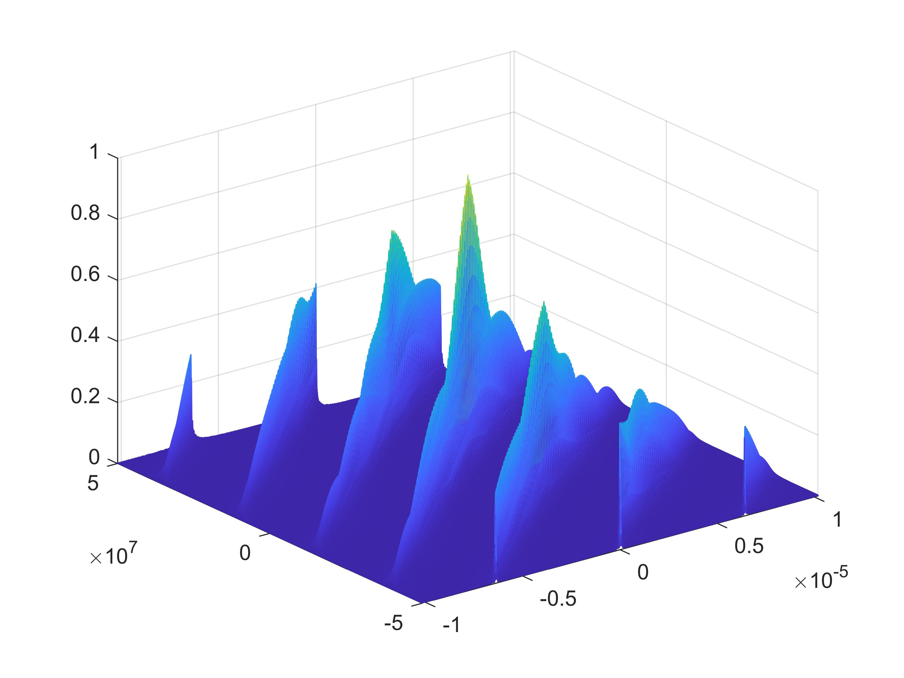
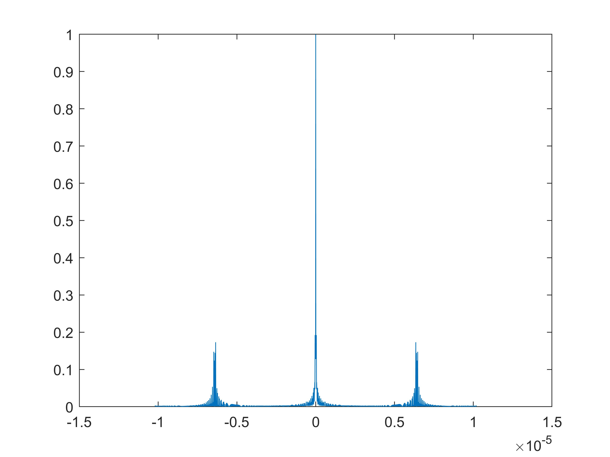
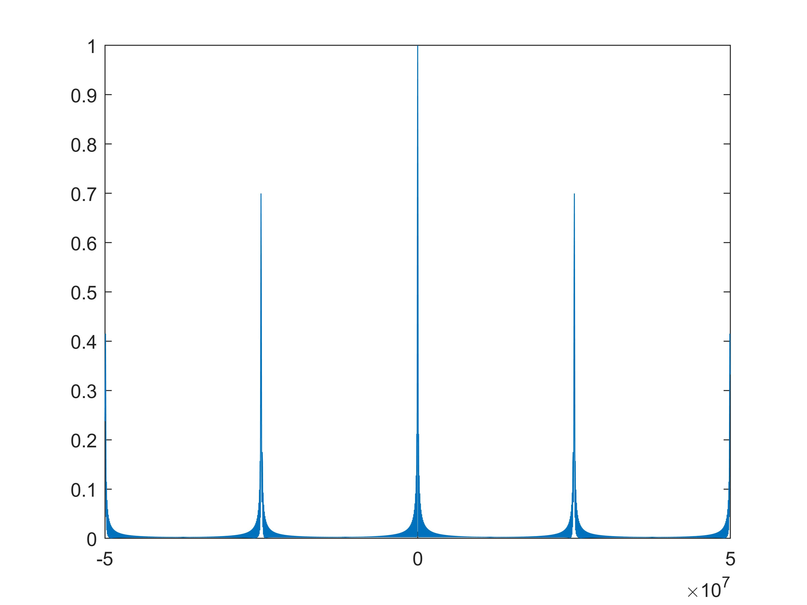
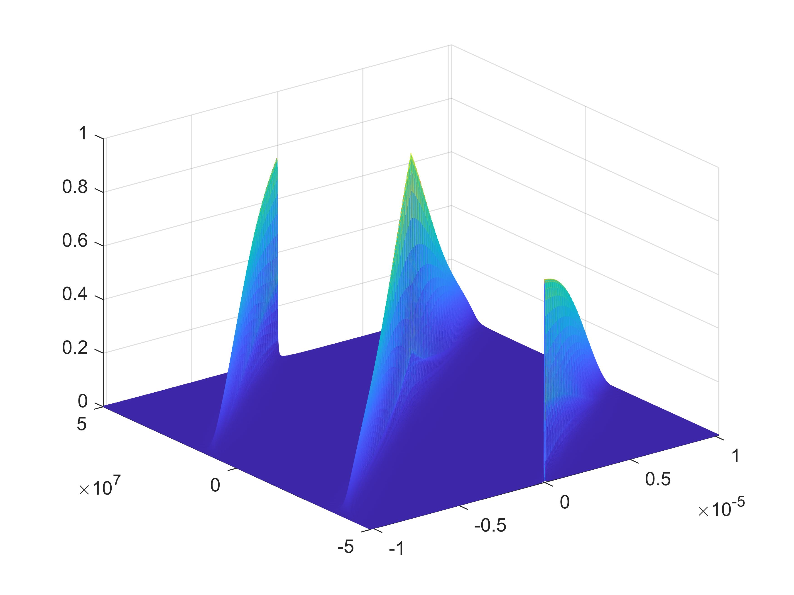
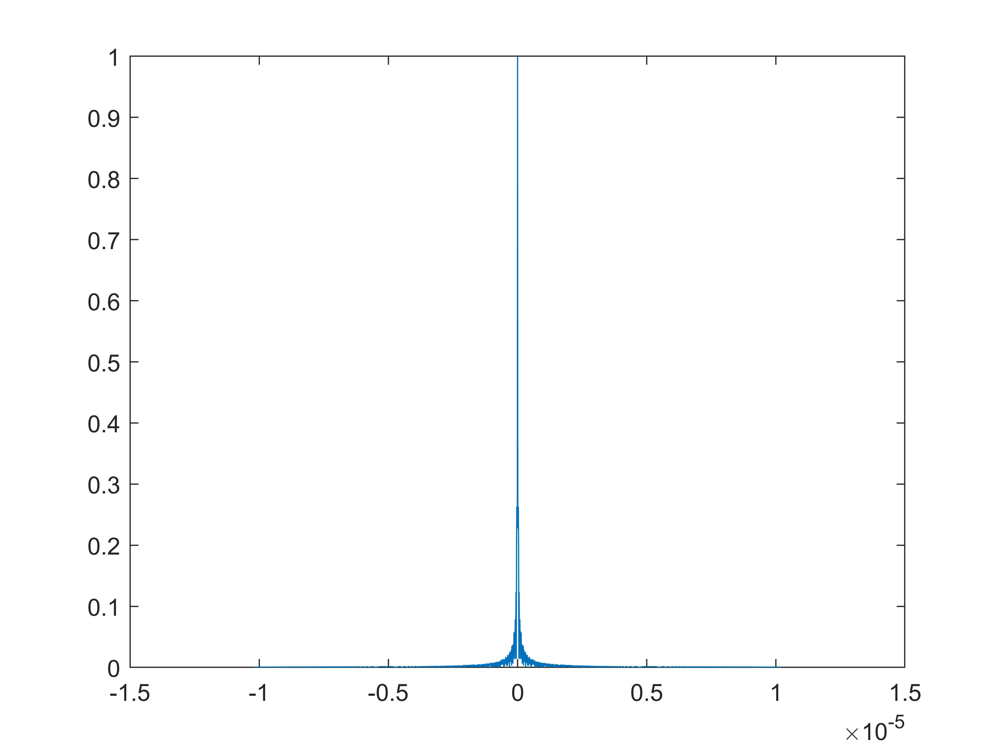
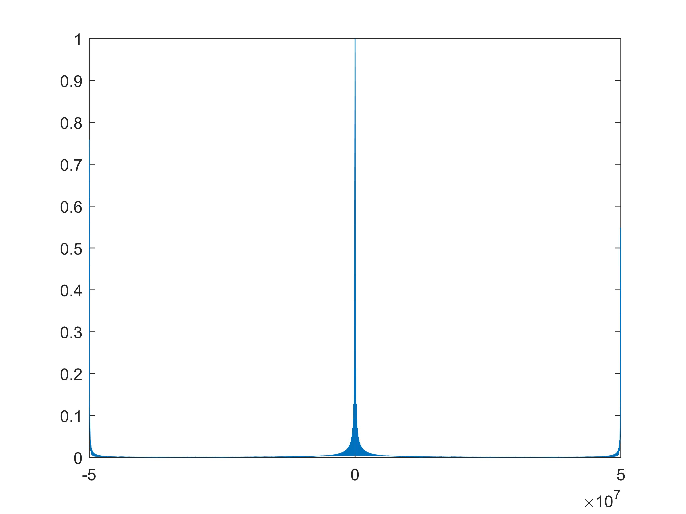
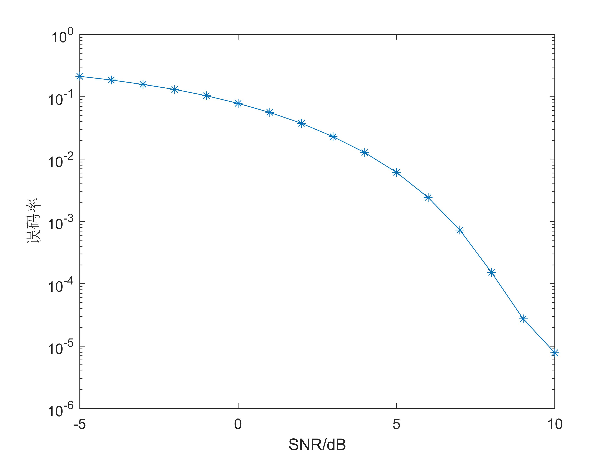

# OFDM-BPSK-LFM radar communication integrated signal performance analysis

This paper is based on OFDM-LFM signals, employing BPSK communication modulation method to modulate the communication information, in order to achieve the design of radar communication integrated waveform. The BPSK integrated signal based on OFDM-LFM has a low bit error rate and can meet the communication conditions, but its fuzzy function is poor, which makes it difficult to meet complex radar detection scenarios. The specific code is attached in the attachment.
The following figure is the blur function and error rate graph of it.
\n        \n  
\n        \n  
\n        \n  
\n        \n  
\n        \n  
\n        \n  
\n        \n  

## Images

<!-- PAYMENT_BLOCK -->

## Get this dataset

- Payment link (Stripe): [Buy now](https://buy.stripe.com/3cs8yP7sY87d0vu9AB)
- Payment QR code: 

<!-- /PAYMENT_BLOCK -->
